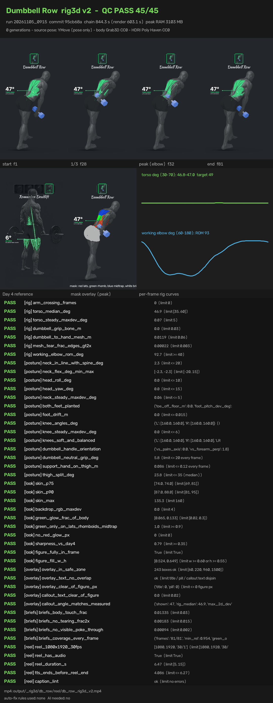

# db_row rig3d v2: QC PASS 45/45

- preview (our own render, 540p): [preview_540p.mp4](preview_540p.mp4)
- full reel on the box: `output/_rig3d/db_row/reel/db_row_rig3d_v2.mp4`
- run 20261105_0915, 844.5 s wall, peak RAM 3103 MB
- 0 generations; source pose YMove (clip not committed); body Grab3D CC0; HDRI Poly Haven CC0
